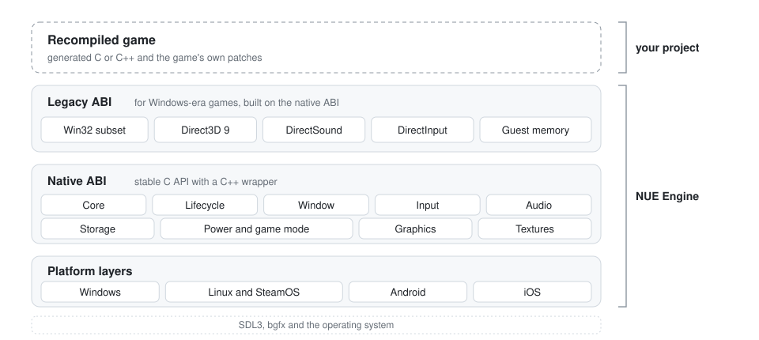

<p align="center">
  <picture>
    <source media="(prefers-color-scheme: dark)" srcset="assets/nue-logo-dark.png">
    
  </picture>
</p>

<h3 align="center">The runtime for static recompilations.</h3>

<p align="center">
  Bring the translated game code. NUE provides everything around it:<br>
  window, input, audio, storage, power, graphics and Win32 / Direct3D 9 compatibility,<br>
  on Windows, Linux (including SteamOS), Android and iOS.
</p>

<p align="center">
  <a href="#why">Why</a> &middot;
  <a href="#the-stack">The stack</a> &middot;
  <a href="#what-you-get">What you get</a> &middot;
  <a href="#status">Status</a> &middot;
  <a href="#build">Build</a> &middot;
  <a href="#documentation">Documentation</a>
</p>

<p align="center">
  
  
  
</p>

## Why

A static recompilation turns a game's machine code into source code you can build for any target. The translated code is only part
of the work. The original program still expects its operating system, its graphics, sound and input APIs, its file layout and its
32-bit memory model, and every recompilation project ends up rewriting that same surface from scratch.

NUE Engine is that surface, written once. A recompilation links against it and only has to supply what is specific to the game.
There are two ways in:

- **Port a Windows-era game.** Link the legacy ABI and the recompiled code keeps calling the Win32, Direct3D 9, DirectSound and
  DirectInput functions it was built for, backed by the native modules underneath.
- **Build something native.** Use the native C API directly (or the C++ wrapper) for a tool, a port or a new game that needs the
  same platform services.

## The stack

<p align="center">
  
</p>

The legacy ABI sits on top of the native one and never the other way round, so a native program links no legacy code. Platform
code is isolated in one layer per operating system, with SDL3 underneath for the parts that are the same everywhere.

## What you get

| Feature | What you get |
|---|---|
| Two ABIs | A stable native C API for new code and a legacy ABI for recompiled Windows-era games. |
| Window and display | Windowed, borderless and full-screen modes, DPI, safe areas, refresh rate, multi-monitor. |
| Input | Keyboard, mouse, gamepads, touch and sensors, with last-used-device detection for the right button glyphs. |
| Audio | Devices and streams with a mixer, conversion and resampling, and latency control. |
| Storage | A virtual file system for game data and user data with case-insensitive paths, async reads, mounts, manifests and per-platform data import. |
| Power and game mode | Game mode on every platform, thermal and battery state, keep-awake and performance hints. |
| Lifecycle | Pause, resume, low memory, focus and display changes as events, the same on every platform. |
| Memory budgets | Budgets are runtime parameters with a default policy per platform. Nothing is hard-coded. |
| Graphics | bgfx (Vulkan, Direct3D 11/12, Metal, OpenGL ES) and a Direct3D 9 layer with a shader translator. |
| Textures | BC/DXT, ETC, ASTC and PVRTC: capability detection, transcoding and a cache. |
| 32-bit guests | Handle tables and guest pointers for recompiled code that expects a 32-bit address space (planned, part of the legacy ABI). |
| Diagnostics | Logging, crash reports and counters, with a deterministic null backend so tests need no window, sound card or GPU. |

## Status

| Module | State |
|---|---|
| Core | Tested on Windows x64 and x86, and on Linux |
| SDL3 backend | Tested with SDL's dummy drivers |
| Windows layer | Tested on Windows |
| Textures | Tested on Windows |
| Direct3D 9 layer | Builds on Windows and matches the system runtime in state tests |
| Linux and SteamOS layer | In development |
| Android layer | In development, builds for arm64 |
| iOS layer | Builds on macOS, not yet run on a device |
| Win32, DirectSound and DirectInput layers, guest memory | Planned |

The per-feature breakdown is kept in [docs/STATUS.md](docs/STATUS.md).

The first game running on NUE is the recompilation of *Need for Speed: Underground 2*, which drives the design of the legacy ABI.

## Build

```
git submodule update --init --depth 1 third_party/SDL
cmake --preset windows-x64
cmake --build --preset windows-x64
ctest --preset windows-x64
```

Presets: `windows-x86`, `windows-x64`, `linux-x64`, `android-arm64`, `ios-arm64`. The Direct3D 9 layer is built with
`-DNUE_WITH_LEGACY_D3D9=ON` after initialising `third_party/bgfx.cmake`.

## Documentation

- [Architecture](docs/ARCHITECTURE.md)
- [Native API](docs/API.md)
- [The two ABIs](docs/ABI.md)
- [Porting a platform](docs/PORTING.md)
- [Graphics and the Direct3D 9 seam](docs/GFX_D3D9_SEAM.md)
- [Status](docs/STATUS.md)
- [Working in the repository](docs/AGENT_GUIDE.md)

## Built on

[SDL3](https://github.com/libsdl-org/SDL), [bgfx](https://github.com/bkaradzic/bgfx) and SPIRV-Cross,
[astc-encoder](https://github.com/ARM-software/astc-encoder), [etcpak](https://github.com/wolfpld/etcpak),
[bcdec](https://github.com/iOrange/bcdec) and [stb_image](https://github.com/nothings/stb).
